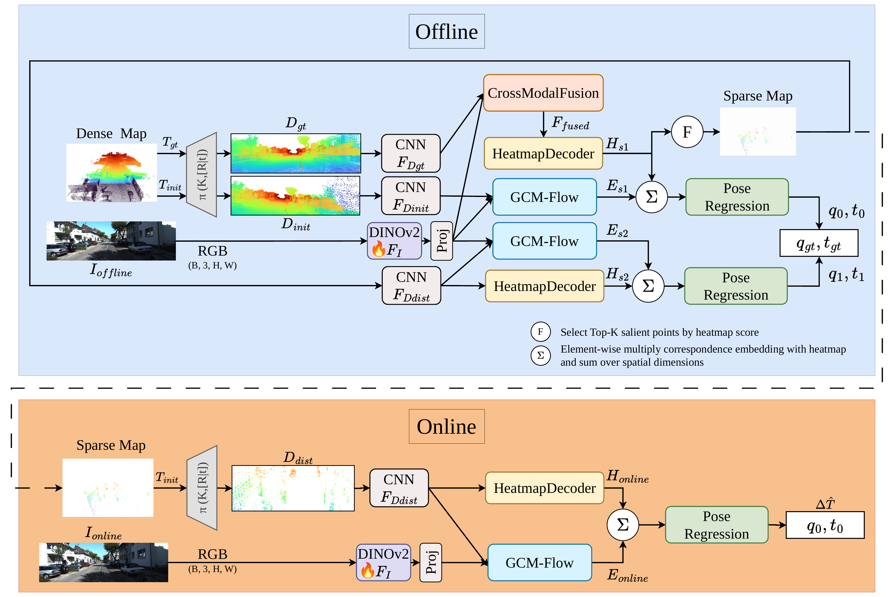

# GCMLoc: Monocular Vehicle Localization with LiDAR Maps via Semantic Enhancement and Global Coarse-to-Fine Cross-Modal Matching

[](#citation)
[](LICENSE)
[](https://www.python.org/downloads/)
[](https://pytorch.org/)

## Abstract

GCMLoc is a LiDAR map-assisted monocular localization framework that refines the 6-DoF
pose of a low-cost camera against a pre-built LiDAR point-cloud map, following a
two-stage paradigm of offline map distillation and online localization. A DINOv2
backbone provides robust semantic image features; a cross-modal semantic–geometric
fusion module guides heatmap generation to distill the dense map into an
information-dense sparse map; and the multi-scale GCM-Flow matcher combines global
matching at the coarsest scale with local correlation-based refinement at finer scales,
remaining reliable under large initial pose errors. Over three coarse-to-fine refinement
rounds, GCMLoc reduces the first-iteration translation error of the baseline by 49.1% on
KITTI and 77.5% on Argoverse, reaching final translation errors of 0.026 m and 0.014 m.

## News / Updates

- **[2026-07]** Initial public release of the GCMLoc codebase (KITTI / Argoverse, single- and mixed-dataset training).

## Overview

[](fig/architecture.pdf)

*Two-stage cross-modal localization pipeline. The offline mapping stage fuses DINOv2
semantic features with LiDAR geometric features to distill the dense map into a sparse,
information-dense map; the online localization stage iteratively refines the camera pose
by matching the image against the projected distilled map with the multi-scale GCM-Flow
matcher.*

## Installation

### Prerequisites

| Requirement | Version |
|-------------|---------|
| Python | 3.10 |
| PyTorch | 2.5.1 + CUDA 12.1 |
| CUDA toolkit | 12.1 (`nvcc` on `PATH`, required to build the `visibility` extension) |
| GPU | ≥ 24 GB VRAM recommended for training (inference needs far less) |

### Environment setup

```bash
# 1. Create and activate a conda environment
conda create -n gcmloc python=3.10 -y
conda activate gcmloc

# 2. Install PyTorch (CUDA 12.1)
pip install torch==2.5.1+cu121 torchvision==0.20.1+cu121 \
    --extra-index-url https://download.pytorch.org/whl/cu121

# 3. Install the remaining dependencies
pip install -r requirements.txt

# 4. Build the CUDA visibility extension (LiDAR point-visibility computation)
export PATH=/usr/local/cuda-12.1/bin:$PATH   # make sure nvcc 12.1 is on PATH
python setup.py build_ext --inplace          # places visibility*.so in the repo root
```

`visibility` is the only custom CUDA extension and is required by every training /
evaluation script (all commands below are run from the repository root, where the built
`.so` is importable). On the first run, the DINOv2 backbone weights are downloaded
automatically via `torch.hub` (internet access required once). 

Verify the installation with:

```bash
python -c "import torch, visibility; print('visibility OK; CUDA available:', torch.cuda.is_available())"
```

Key dependencies (see `requirements.txt` for the pinned list): `torch==2.5.1+cu121`,
`numpy`, `sacred`, `mathutils`, `opencv-python`, `h5py`, `pandas`, `matplotlib`, `scipy`;
`open3d`, `pykitti` and `PyYAML` are only needed for the preprocessing scripts.

## Dataset Preparation

Datasets are not distributed with this repository and must be obtained from their
official sources. The `data_folder` argument is pointed at the corresponding dataset root.

### KITTI Odometry

The framework is evaluated on the [KITTI Odometry benchmark](http://www.cvlibs.net/datasets/kitti/eval_odometry.php).
The expected directory layout is:

```
KITTI_ODOMETRY/
└── sequences/
    ├── 00/
    │   ├── image_2/        # left camera images
    │   ├── velodyne/       # LiDAR scans (.bin)
    │   ├── calib.txt       # KITTI calibration (from the odometry download)
    │   ├── times.txt       # KITTI timestamps (from the odometry download)
    │   └── poses.csv       # SLAM ground-truth poses (copied from data/, see below)
    ...
```

Data preparation follows [CMRNet](https://github.com/cattaneod/CMRNet): the map-building
script and the SLAM ground-truth poses (`data/kitti-{seq}.csv`, sequences 00, 03, 05–09)
are included in this repository, so no external code is needed. A voxelised point-cloud
map is constructed per sequence with:

```bash
cp data/kitti-00.csv ./KITTI_ODOMETRY/sequences/00/poses.csv   # ground-truth poses for the loader
python preprocess/kitti_maps.py --sequence 00 --kitti_folder ./KITTI_ODOMETRY --voxel_size 0.1
```

which writes the per-frame local maps to `<sequence>/local_maps_0.1/*.h5` (the
`maps_folder` default of the mapping stage). Repeat for sequences 03 and 05–09.

### Argoverse

Download the four train sets of `Argoverse 3D Tracking v1.1` from the
[official website](https://www.argoverse.org/av1.html#download-link) and extract them
under one root (e.g. `./data/argoverse-tracking/train1` … `train4`; train1–3 are used for
training, train4 for validation). The per-log LiDAR maps follow the
[CMRNext](https://github.com/robot-learning-freiburg/CMRNext) format; please generate
them with CMRNext's *LiDAR Map Generation* procedure (`preprocess/argoverse.py`, run
inside the Docker environment provided by that repository). After this step every log
should contain the global map `<log>/map.h5` and the per-frame camera poses
`<log>/ring_front_center/poses_torch/<ts>.npy`; camera intrinsics are read from the
dataset's own `<log>/vehicle_calibration_info.json`. Argoverse is then selected with
`dataset=argo data_folder=./data/argoverse-tracking`.

### Fixed test-time initial offsets (`data/test_RT/`)

At test time every frame is perturbed by a **fixed** initial pose offset read from a
`test_RT_*.csv` file (columns `id, tx, ty, tz, rx, ry, rz`), so that all methods are
evaluated from *identical* initial displacements. The exact CSVs used in our experiments
are shipped in `data/test_RT/{kitti,argoverse}/`. Before running evaluation, copy them
into the corresponding dataset root, where the data loaders look for them:

```bash
cp data/test_RT/kitti/*.csv     ./KITTI_ODOMETRY/sequences/
cp data/test_RT/argoverse/*.csv ./data/argoverse-tracking/
```

If a `test_RT` CSV is missing, the loader generates a new random one — results are then
still valid but no longer frame-by-frame comparable with the published numbers. When
comparing your own method against GCMLoc, please use these CSVs as the initial offsets.

## Training

The pipeline comprises four steps: **mapping → map-feature saving → localization →
evaluation.** All scripts are configured with [Sacred](https://github.com/IDSIA/sacred):
parameters are overridden on the command line with the `with key=value` syntax.

### Step 1 — Offline mapping

```bash
# KITTI (sequence 00 held out for validation)
python train_mapping.py with \
    dataset=kitti data_folder=./KITTI_ODOMETRY/sequences test_sequence=0 \
    epochs=120 batch_size=8 max_r=10 max_t=2

# Argoverse (train1-3 for training, train4 for validation)
python train_mapping.py with \
    dataset=argo data_folder=./data/argoverse-tracking \
    epochs=120 batch_size=8 max_r=10 max_t=2

# Lightweight model (GCMLoc-S): append  dinov2_variant=s
```

Each run writes to `checkpoints/<dataset>/<seq|argo|mixed>/<timestamp>_GCMLoc-<B|S>_mapping/`:
the best checkpoint (`checkpoint_r10.00_t2.00_e<epoch>_<val_loss>_mapping.tar`),
`checkpoint_latest_mapping.tar` (pass it as `resume=` to continue an interrupted run),
`train_log.csv` and `loss_curve.png`.

### Step 2 — Map-feature saving

```bash
python train_save.py with \
    dataset=kitti data_folder=./KITTI_ODOMETRY/sequences test_sequence=0 \
    weights=<mapping_checkpoint>.tar \
    save_root=./KITTI_ODOMETRY/sequences save_name=v2_pcl save_split=test
```

The script runs Stage-1 inference of the mapping network on every frame of the split and
writes the distilled sparse map to `<save_root>/<sequence>/<save_name>/<frame>.npy`.
`save_name=v2_pcl` is the folder name that the localization stage reads by default
(`maps_folder=v2_pcl`).
For KITTI run it once per sequence (`save_split=test` saves `test_sequence`); for
Argoverse `save_split=train|test` selects the split.

`run_all_saves.sh` batches this step over all sequences / splits of one dataset (KITTI
sequences 00, 03, 05–09; Argoverse train + test splits). Parameters are passed as
environment variables, only `WEIGHTS` is required:

```bash
# single-dataset checkpoint
WEIGHTS=<mapping_checkpoint>.tar bash run_all_saves.sh kitti
WEIGHTS=<mapping_checkpoint>.tar bash run_all_saves.sh argo

# checkpoint trained with dataset=mixed (canonical camera)
WEIGHTS=<MAP_CKPT> SAVE_NAME=v2_pcl_mix USE_CANONICAL=True CANON_PRESET=A bash run_all_saves.sh kitti
```

Optional variables: `SAVE_NAME` (default `v2_pcl`), `USE_CANONICAL` / `CANON_PRESET`,
`KITTI_ROOT` / `ARGO_ROOT` (dataset roots), `KITTI_SEQS` (default `"0 3 5 6 7 8 9"`),
`SAVE_ROOT` (output root, defaults to the dataset root) and `BATCH_SIZE`.

### Step 3 — Online localization (iterative)

```bash
# round 1 — initialise from the mapping checkpoint
python train_loc.py with \
    dataset=kitti data_folder=./KITTI_ODOMETRY/sequences test_sequence=0 \
    maps_folder=v2_pcl weights=<mapping_checkpoint>.tar \
    epochs=300 batch_size=8 max_r=10 max_t=2

# rounds 2 / 3 — initialise from the previous round's best *_loc.tar
python train_loc.py with ... epochs=200 max_r=2 max_t=1 weights=<round1_best_loc.tar>
python train_loc.py with ... epochs=200 max_r=1 max_t=0.6 weights=<round2_best_loc.tar>
```

Each run writes to
`checkpoints/<dataset>/<seq|argo|mixed>/<timestamp>_GCMLoc-<B|S>_loc_r<max_r>_t<max_t>/`
(best `*_loc.tar`, `checkpoint_latest_loc.tar` for `resume=`, `train_log.csv`,
`loss_curve.png`).

| Round | `max_r` (deg) | `max_t` (m) |
|:-----:|:-------------:|:-----------:|
| 1 | 10.0 | 2.0 |
| 2 | 2.0 | 1.0 |
| 3 | 1.0 | 0.6 |

Architecture constants (feature dimension 128, 5000 retained points per frame, 4 fine-tuned
DINOv2 blocks, cross-modal fusion, multi-scale GCM-Flow) are fixed in the `ARCH` block of
`train_mapping.py` and stored in every checkpoint.

### Mixed-dataset pipeline (KITTI + Argoverse)

`dataset=mixed` jointly samples KITTI and Argoverse: all images are warped to a
canonical virtual camera (`canon_preset=A`, 768×384) and the two datasets are drawn
under a weighted sampler (`mixed_weight_kitti` / `mixed_weight_argo`). The same
`canon_preset` must be used consistently across all four steps below:

```bash
# 1) Offline mapping, jointly trained on KITTI + Argoverse
python train_mapping.py with \
    dataset=mixed canon_preset=A \
    kitti_data_folder=./KITTI_ODOMETRY/sequences \
    argo_data_folder=./data/argoverse-tracking \
    mixed_weight_kitti=1.0 mixed_weight_argo=2.0 \
    epochs=120 batch_size=8 max_r=10 max_t=2
#    (canonical warping is always on for dataset=mixed; `maps_folder` names the KITTI
#     local-map folder, Argoverse always reads <log>/map.h5)  → produces <MAP_CKPT>

# 2) Save the distilled maps for both datasets (all sequences / splits)
export WEIGHTS=<MAP_CKPT> SAVE_NAME=v2_pcl_mix USE_CANONICAL=True CANON_PRESET=A
bash run_all_saves.sh kitti
bash run_all_saves.sh argo

# 3) Online localization, jointly trained on KITTI + Argoverse (3 rounds as in Step 3)
python train_loc.py with \
    dataset=mixed canon_preset=A \
    kitti_data_folder=./KITTI_ODOMETRY/sequences \
    argo_data_folder=./data/argoverse-tracking \
    maps_folder=v2_pcl_mix mixed_weight_kitti=1.0 mixed_weight_argo=2.0 \
    weights=<MAP_CKPT> epochs=100 batch_size=8 max_r=10 max_t=2
#    → produces <LOC_CKPT>

# 4) Evaluate the mixed-trained checkpoints on both datasets
python evaluate_multidataset.py with "datasets=['kitti','argo']" \
    use_canonical=True canon_preset=A maps_folder=v2_pcl_mix \
    "weight=['<iter1>.tar','<iter2>.tar','<iter3>.tar']"
```

## Evaluation

Iterative evaluation applies a sequence of localization checkpoints, each refining the
estimate from the previous iteration:

```bash
python evaluate.py with \
    dataset=kitti data_folder=./KITTI_ODOMETRY/sequences test_sequence=0 split=test \
    maps_folder=v2_pcl max_r=10 max_t=2 \
    "weight=['<iter1>.tar','<iter2>.tar','<iter3>.tar']" results_dir=./results
```

To evaluate one mixed-trained checkpoint set across several datasets in a single
invocation (per-dataset sub-folders plus a combined `summary_all.txt`):

```bash
python evaluate_multidataset.py with \
    "datasets=['kitti','argo']" \
    "weight=['<iter1>.tar','<iter2>.tar','<iter3>.tar']" \
    use_canonical=True canon_preset=A \
    maps_folder=v2_pcl_mix max_r=10 max_t=2 results_root=./results_mixtest
```

**Results** (KITTI Odometry sequence 00, GCMLoc-B checkpoints, `evaluate.py` command above):

| Iteration | Median Transl. Error (m) | Median Rot. Error (deg) |
|:---------:|:------------------------:|:-----------------------:|
| 1 | 0.142 | 0.876 |
| 2 | 0.043 | 0.362 |
| 3 | 0.026 | 0.270 |

## Pretrained Weights

Pretrained checkpoints will be provided via Google Drive:

| Checkpoint | Description | Link |
|------------|-------------|------|
| `mapping.tar` | Stage-1 mapping network (mixed KITTI + Argoverse, canonical preset A) | *coming soon* |
| `loc_iter1.tar` / `loc_iter2.tar` / `loc_iter3.tar` | Stage-2 localization checkpoints for the three refinement iterations | *coming soon* |

Place the downloaded files under `./weights/` (kept separate from your own training
outputs in `./checkpoints/`) and pass their paths via `weights=` / `weight=[...]`.
Each checkpoint embeds its architecture config, which the loaders validate against the
weights (GCMLoc-B / GCMLoc-S is detected automatically), so no additional flags are
required to load it.

## Repository Structure

```
GCMLoc/
├── checkpoints/                # training outputs / pretrained weights (created at runtime)
├── data/
│   ├── argoverse-tracking/     # Argoverse dataset root (see Dataset Preparation)
│   │   └── train<1-4>/<log>/{ring_front_center/ (images + poses_torch/), map.h5,
│   │                         vehicle_calibration_info.json, v2_pcl/}
│   ├── kitti-*.csv             # KITTI ground-truth poses
│   └── test_RT/                # fixed test-time initial offsets (see above)
├── fig/                        # architecture figure
├── KITTI_ODOMETRY/             # KITTI dataset root (see Dataset Preparation)
│   └── sequences/<seq>/{image_2/, velodyne/, calib.txt, times.txt, poses.csv,
│                        local_maps_0.1/, v2_pcl/}
├── models/
│   ├── backbone/               # DINOv2 RGB backbone, three-branch depth CNN
│   ├── fusion/                 # cross-modal semantic–geometric fusion, GCM-Flow matcher
│   ├── GCMLoc/                 # GCMLocMapping (offline), GCMLocLocalization (online), checkpoint helpers
│   └── heads/                  # heatmap decoder / head, pose regressor
├── preprocess/                 # KITTI map building (kitti_maps.py)
├── src/                        # CUDA visibility extension (built via setup.py)
├── weights/                    # place downloaded pretrained checkpoints here
├── camera_model_{mapping,localization}.py
├── combined_dataset.py         # weighted mixed-dataset sampler
├── Dataset_{kitti,argoverse}_{mapping,localization}.py
├── evaluate.py                 # iterative evaluation (pose errors + per-module timing)
├── evaluate_multidataset.py    # one checkpoint set evaluated across datasets
├── losses.py                   # pose regression loss
├── run_all_saves.sh            # batch distilled-map saving (kitti / argo)
├── train_loc.py                # online localization training (3 rounds)
├── train_mapping.py            # offline mapping training (kitti / argo / mixed)
├── train_save.py               # distilled-map saving from a mapping checkpoint
└── utils.py / utils_canonical.py / quaternion_distances.py / timing_record.py
```

## Citation

A publication describing GCMLoc is in preparation; citation information will be added
upon release.

## License

This project is released under the [MIT License](LICENSE). Files inherited from
[CMRNet](https://github.com/cattaneod/CMRNet) keep the license stated in their headers
([CC BY-NC-SA 4.0](http://creativecommons.org/licenses/by-nc-sa/4.0/)).

## Acknowledgements

GCMLoc is built on the shoulders of several open-source projects and public datasets.
We are grateful to their authors and maintainers:

- LHMap-loc: https://github.com/IRMVLab/LHMap-loc
- CMRNet: https://github.com/cattaneod/CMRNet
- CMRNext: https://github.com/robot-learning-freiburg/CMRNext
- DINOv2: https://github.com/facebookresearch/dinov2
- GMFlow: https://github.com/haofeixu/gmflow
- KITTI Odometry benchmark: https://www.cvlibs.net/datasets/kitti/
- Argoverse: https://www.argoverse.org/av1.html

We also thank the Industrial Technology Research Institute (ITRI), Taiwan, for their
support of this research.
